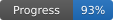

# Wii Party Recomp

Static recompilation of Wii Party for native PC.

> [!NOTE]
> **Project Status:** Alpha. The game boots, reaches every menu and plays complete Board Game Island sessions and every Free Play minigame. Progress is estimated at **93%** overall.



**[Download all platforms (Nightly releases)](https://github.com/NVDEMU/wiiparty-recomp-better/releases/tag/Nightly)** · Windows x64 · Linux x86_64 · macOS Apple Silicon and Intel

## Overview

Wii Party Recomp translates the game's PowerPC code into C++ and compiles it into a native Windows or Linux program. The game and Nintendo SDK code run translated; only what depends on the console hardware is replaced, and the hardware itself (GPU, DSP audio, Bluetooth, IOS, disc and NAND) is reimplemented underneath. The game's own audio microcode is recompiled too.

No game files are distributed. The launcher builds the game on your computer from your own copy of the disc. Windows, Linux and macOS launchers are built by GitHub Actions; native runtime/gameplay still needs testing on real machines.

## Current State & Metrics

The game runs at a locked **60 fps** (PAL60) at up to 6x the console's resolution, using about 1.5 CPU threads and about 600 MB of RAM.

Tracked in `games/wiiparty/analysis/progress.csv`:

| Component | Progress | Basis |
| :--- | :--- | :--- |
| **Recompilation Toolchain** | **100%** | The DOL and all 115 REL modules translate and build; every instruction kind the game uses is checked by 4,152 tests against an independent model. |
| **System Runtime** | **100%** | OS, threads, interrupts, IPC, DVD, NAND, Bluetooth, the EXI bus, the SI ports, the GPU command FIFO and the pixel engine interrupts work, with no known unemulated parts. |
| **Graphics (GX to D3D11)** | **100%** | Menus, text, 3D models, lit Miis, TEV, indirect textures, fog and EFB copies; no known fault in any minigame. |
| **Audio Pipeline** | **100%** | Recompiled AX microcode; its output matches Dolphin's sample for sample on the title music; Wii Remote speaker sound is played. |
| **Game Flow** | **90%** | A full 17-round Board Game Island game; every Free Play minigame played by hand, all 79 without faults. |
| **Input System** | **80%** | Emulated Wii Remote over emulated Bluetooth; keyboard, mouse, up to four gamepads and real Wii Remotes; an optional window on the minigame explanation screens lists the PC key of each button. |
| **PC Features** | **80%** | Single-file launcher, Mii file loading, in-game options menu (F10), key bindings, save backups, custom texture-pack manager, window-resolution presets, subtle color/contrast enhancement, screenshots, and input replay recording/playback. True ultrawide camera expansion and online play remain planned. |

### Known Limitations

- The modes other than Board Game Island and Free Play have been tried but not played through in full.
- Real Wii Remotes paired with the PC are used by the game, but pointing with a physical sensor bar has not been tested.
- Some PCs reach less than 60 fps on the Board Game Island and in minigames; performance work is in progress.
- The launcher is not code-signed, so Windows Defender may flag it as a false positive. Every release lists its SHA-256 on GitHub, and the source code of the launcher is in this repository.

## Installing

1. Download `wiipartyrecomp-launcher.exe` from the [Nightly release](https://github.com/NVDEMU/wiiparty-recomp-better/releases/tag/Nightly). The optional `wiipartyrecomp-windows-x86_64.zip` contains the same launcher.
2. Open it, check the install folder, choose your own copy of Wii Party (`.iso`, `.wbfs`, `.rvz`, `.ciso`, `.wia` or `.gcm`) and press **Install**.
3. When it finishes, press **Play**.

The launcher downloads any missing build tools from their official sites and checks each one against its published SHA-256. Nothing from the game is downloaded and nothing leaves your computer.

**Internet requirement:** this fork currently publishes the online launcher only. On first install, it downloads build tools from their official sources and verifies their SHA-256; the optional offline Windows tool bundle is not included yet.

| Requirement | |
| :--- | :--- |
| System | Windows 10 or 11, 64-bit |
| Free space | About 5 GB |
| Memory | 4 GB minimum, 8 GB or more recommended for the build |
| Build time | About 10 minutes on a 6-core processor; longer on slower machines |

### Linux (experimental)

1. Install the build tools with your package manager:
   - Debian and Ubuntu: `sudo apt install g++ cmake ninja-build python3 curl libx11-dev libxext-dev libxrandr-dev libxcursor-dev libxi-dev libxss-dev libxtst-dev libxkbcommon-dev libwayland-dev wayland-protocols libdecor-0-dev libegl-dev libgl-dev libpulse-dev libasound2-dev libudev-dev libdbus-1-dev`
   - Fedora: `sudo dnf install gcc-c++ cmake ninja-build python3 curl libX11-devel libXext-devel libXrandr-devel libXcursor-devel libXi-devel libXScrnSaver-devel libXtst-devel libxkbcommon-devel wayland-devel wayland-protocols-devel libdecor-devel mesa-libEGL-devel mesa-libGL-devel pulseaudio-libs-devel alsa-lib-devel systemd-devel dbus-devel`
   - Arch: `sudo pacman -S --needed gcc cmake ninja python curl sdl3`
2. Download `wiipartyrecomp-launcher-x86_64.AppImage` from the [Nightly release](https://github.com/NVDEMU/wiiparty-recomp-better/releases/tag/Nightly), make it executable (`chmod +x wiipartyrecomp-launcher-x86_64.AppImage`, or Properties > Permissions in your file manager) and open it.
3. Choose your disc and press **Install**, then **Play**. The launcher downloads only nodtool; the game is installed in `~/.local/share/WiiPartyRecomp`.

The AppImage targets x86_64 and needs glibc 2.38 or newer (Ubuntu 24.04, Debian 13, Fedora 39 or later); the game needs OpenGL 4.1. CI builds the package, but real-machine gameplay on Linux still needs tester validation.

The build runs once, at low priority, with as many parallel jobs as your memory allows. Updating to a newer launcher rebuilds the game and keeps your saves and settings.

### macOS (experimental)

1. Install Apple's Command Line Tools if they are not already installed. In Terminal, run `xcode-select --install`; the game needs Apple's C++ compiler. Python, CMake, Ninja and the disc extraction tool are downloaded by the launcher.
2. Download **[WiiPartyRecomp-macos-arm64.dmg](https://github.com/NVDEMU/wiiparty-recomp-better/releases/tag/Nightly)** on Apple Silicon, or **WiiPartyRecomp-macos-x86_64.dmg** on an Intel Mac, from the Nightly release.
3. Open the DMG and drag **Wii Party Recomp.app** to Applications.
4. Open the launcher, choose your own Wii Party disc image, and press **Install**. The launcher compiles the game locally.
5. The app is ad-hoc signed but not Developer ID signed or notarized, so Gatekeeper may still warn. If macOS blocks the app, Control-click it in Finder and choose **Open**, then confirm the prompt.

The DMG contains the launcher, not the game. You must provide your own legally obtained Wii Party disc image. The macOS CI build and DMG packaging pass on Apple Silicon and Intel. A full game playthrough on physical Macs still needs testing.

## Controls

Every key can be changed on the launcher's **Controls** page or in `games/wiiparty/settings.ini`. Up to four gamepads act as Wii Remotes 1 to 4, with gyroscope pointer, motion, rumble and player lights.

| Wii Remote | Keyboard and mouse |
| :--- | :--- |
| Pointer | Mouse |
| A / B | Left click, Enter or Space / Right click or Backspace |
| 1 / 2 | 1 / 2 |
| + / - / HOME | Plus / Minus / H |
| D-pad | Arrow keys, W A S D |
| Shake | Middle click or Left Shift |
| Swing up / down | Mouse wheel, T / G |
| Tilt | Q, E, R, F |
| Upright or sideways grip | Tab |

| PC key | Action |
| :--- | :--- |
| F6 | Start/stop input replay recording; saves `games/wiiparty/replays/last.wpr` |
| F7 | Play the most recently recorded replay |
| F9 | Screenshot to the `screenshots` folder |
| F10 | Options menu over the game |
| F11 | Full screen |
| F12 | Frame capture for debugging |

## Roadmap

| Stage | When it is reached |
| :--- | :--- |
| **Alpha** (current) | The game runs from start to finish, with known bugs and features still missing. |
| **Beta** | Every mode and all 80 minigames are checked, including the pair minigames; no known crashes; the known graphics faults in `docs/MINIGAMES.md` are fixed; the install is tested on several different PCs. |
| **1.0** | No known bugs, overall progress around 95%, and a period of use by players without serious problems. |

The project's scope is the original game, faithful and optimized.

### Planned features

| Feature | Notes |
| :--- | :--- |
| **True ultrawide rendering** | Correct wider camera framing and gameplay projection, rather than stretching the 16:9 image. Still planned; the new resolution presets change window size only. |
| **Online play with friends** | A fourth, green **Online** button next to the three buttons at the bottom of the main menu. There is no server: players connect directly, and the game exchanges only each player's inputs in lockstep. Not started. |

The launcher has a Miis page that imports individual or batch Wii Mii files and whole Wii Mii databases (up to 100 Miis). Database updates retain an `.bak` copy of the previous database. The texture page imports PNG texture-pack folders, toggles packs on/off, and opens the active folder. The launcher does not bundle third-party or game-derived texture assets; add your own legally obtained packs. A Mii editor of its own is not planned.

### Platforms

- **Windows 10 and 11 x64:** launcher EXE and ZIP are built by CI; game/runtime should be tested on Windows hardware.
- **Linux x86_64:** AppImage is built by CI; requires glibc 2.38+ and OpenGL 4.1. Full gameplay still needs testing across distributions and GPUs.
- **macOS:** Apple Silicon and Intel DMGs pass CI and are ad-hoc signed, but not notarized. Full gameplay and controller behavior need testing on physical Macs.

## Repository Layout

```
├── engine/             # Core reusable Wii engine
├── recompiler/         # PowerPC & DSP static recompilation pipelines
├── games/wiiparty/     # Wii Party configuration and analysis
├── launcher/           # Installer and settings (SDL3 + Dear ImGui)
├── tools/              # Developer scripts
├── tests/              # Test suites
└── docs/               # Technical notes and progress
```

## Building from Source

Requirements: Python 3.11+, CMake 3.20+, Ninja, a MinGW-w64 GCC 13+ and [nodtool](https://github.com/encounter/nod).

```bash
nodtool extract games/wiiparty/disc/wiiparty.rvz games/wiiparty/extracted
python tools/fetch_sdl.py
python recompiler/unpack_rels.py
python recompiler/recomp.py
python recompiler/recomp_rel.py --all
python recompiler/recomp.py
python recompiler/dsp/recomp_dsp.py
cmake -S . -B build/out -G Ninja -DCMAKE_BUILD_TYPE=Release
cmake --build build/out --target wiiparty
./build/out/wiiparty
```

The launcher builds with the same compiler; CMake downloads its libraries:

```bash
cmake -S launcher -B build/launcher -G Ninja -DCMAKE_BUILD_TYPE=Release
cmake --build build/launcher
```

Technical notes and the history of every change are in `docs/DECOMP_PROGRESS.md`. See `CONTRIBUTING.md` before opening a pull request.

## Legal & Licensing

Independent project not affiliated with or endorsed by Nintendo. Users must supply their own legally obtained game files.

Licensed under the GPL-3.0-or-later. Third-party code and libraries are listed in `THIRD_PARTY_NOTICES.md`.
